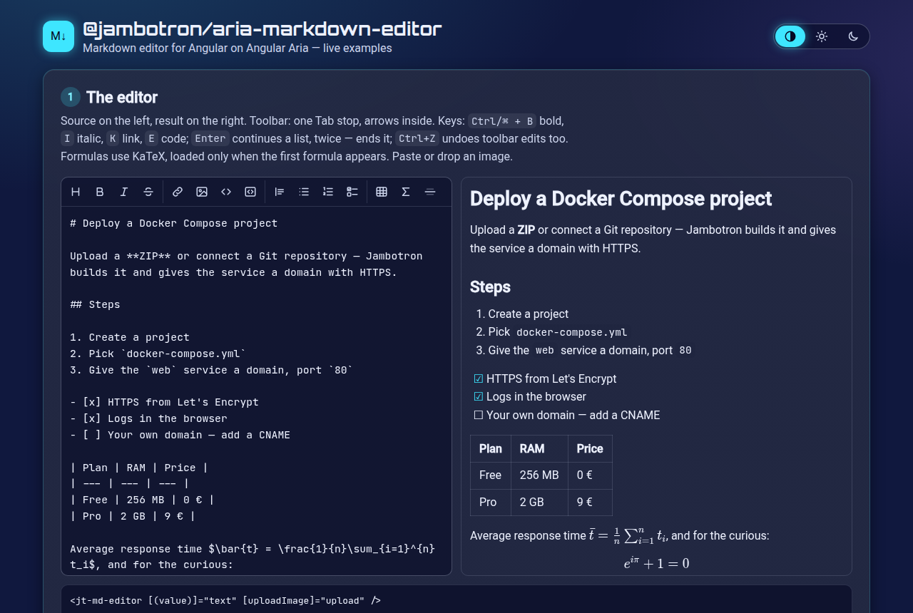
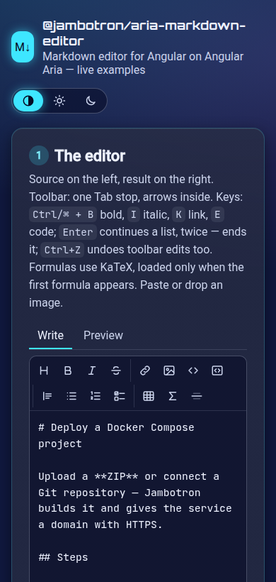
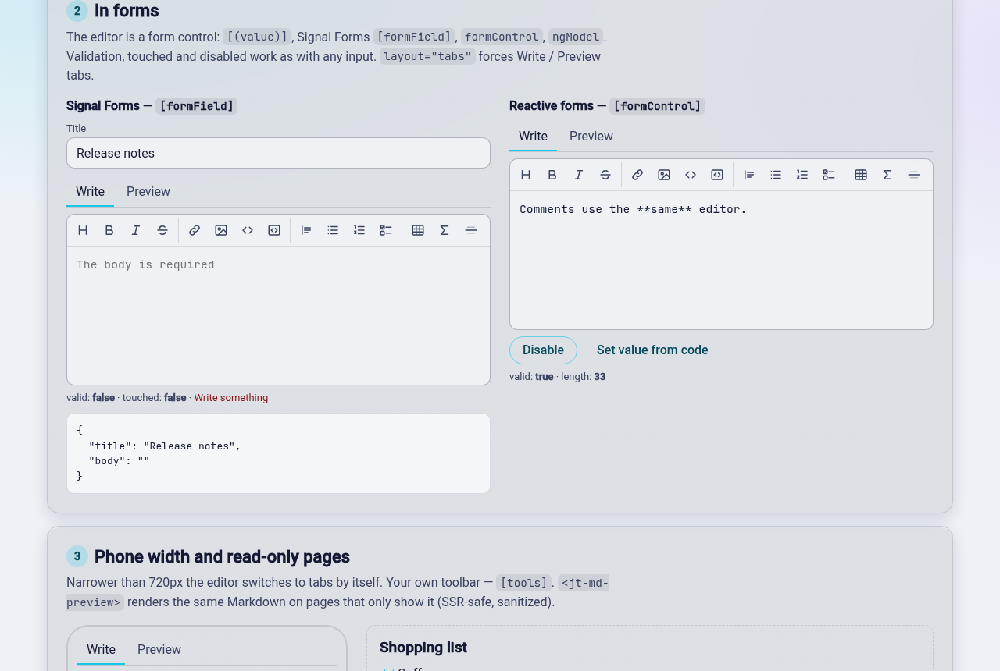

## Abstract

This article is a practical guide to **@jambotron/aria-markdown-editor**, the Markdown editor we use for tutorials on jambotron.com. It shows how to use it: installing the package, putting the editor on a page, connecting it to forms, uploading images, turning on formulas, translating the texts and showing the same Markdown on read-only pages. Every step is backed by a live demo with three examples and a light and a dark theme, deployed on Jambotron from one Docker Compose file.

**Keywords:** Angular, Markdown editor, Angular Aria, accessibility, Signal Forms, ControlValueAccessor, KaTeX, image upload, theming.

---

## 1. Introduction

Many apps need a place where people write formatted text: a post, a tutorial, a release note, a comment. Markdown fits well. It is plain text, it is easy to store and to diff, and people who write code already know it. A bare `<textarea>` is not enough, though. Writers want to see the result, press Ctrl+B, paste a screenshot, and a phone has no room for two columns.

@jambotron/aria-markdown-editor packs this into one component:

- source and live preview side by side, and **Write / Preview tabs** when the editor is narrower than 720px;
- a toolbar with 15 buttons: heading, bold, italic, strikethrough, link, image, inline code, code block, quote, three kinds of lists, table, formula and horizontal line;
- hotkeys Ctrl/⌘ + B, I, K and E. Enter continues a list, and Enter on an empty item ends it;
- **Ctrl+Z works** for toolbar edits too, because they go through the browser's own undo;
- images: paste from the clipboard, drop a file, or choose one. Your function uploads it and returns the address;
- formulas `$…$` and `$$…$$` drawn by KaTeX, which is **loaded only when the first formula appears**;
- forms: `[(value)]`, Signal Forms `[formField]`, `formControl` and `ngModel`;
- `<jt-md-preview>`, the same rendering for pages that only show the text.

The toolbar and the tabs are built on [Angular Aria](https://angular.dev/guide/aria/overview), so keyboard and screen-reader support come from the same patterns as the rest of the app.



---

## 2. The demo

The demo is a small Angular app with three sections.

| Section | What it shows |
|---|---|
| 1. The editor | A full article: lists, task list, table, formulas, code. Paste or drop an image, and it "uploads" in the browser |
| 2. In forms | Signal Forms with a required field and live form state; a reactive `FormControl` that you can disable or set from code |
| 3. Phone width and read-only pages | The editor in a 360px frame with tabs and a short toolbar, next to `<jt-md-preview>` |

A switch at the top changes the theme: auto, light or dark. The theme and the icons come from [@jambotron/aria-components](https://aria-components-demo.jambocheck.com), our UI component package.

---

## 3. Installation

### 3.1 Requirements

Angular 22 with `@angular/aria` and `@angular/forms`, plus `marked` 16 or newer for parsing Markdown. Formulas need `katex`. Icons come from `@jambotron/aria-components`. Angular Material is not needed.

### 3.2 The package

The package is published in the public npm registry of our Gitea. No token is needed. Tell npm where the `@jambotron` scope lives. A `.npmrc` file in the project root also works in Docker builds:

```
@jambotron:registry=https://gitea.jambotron.com/api/packages/jambotron_gang/npm/
```

```bash
npm install @jambotron/aria-markdown-editor @jambotron/aria-components marked katex
```

### 3.3 Setup and styles

One provider in `app.config.ts`. The `katex` function is called on the first formula, so the bundler puts KaTeX into a separate chunk:

```ts
import { provideJtMarkdown } from '@jambotron/aria-markdown-editor';

export const appConfig: ApplicationConfig = {
  providers: [
    provideJtMarkdown({ katex: () => import('katex').then(m => m.default) })
  ]
};
```

Global styles: the theme tokens and the KaTeX stylesheet.

```scss
@use '@jambotron/aria-components/styles/aria-components';
@use 'katex/dist/katex.min.css';
```

In the demo build, KaTeX is a lazy chunk of 64 KB (gzip). It is not in the main bundle.

---

## 4. The first editor

```ts
import { JtMdEditorComponent } from '@jambotron/aria-markdown-editor';

@Component({
  imports: [JtMdEditorComponent],
  template: `<jt-md-editor [(value)]="text" placeholder="Write Markdown…" />`
})
export class PostEditor {
  readonly text = signal('# Hello');
}
```

That is all you need. The value is a plain string, the Markdown source.

### 4.1 Inputs

| Input | Default | Meaning |
|---|---|---|
| `value` (model) | `''` | The Markdown text |
| `placeholder` | `''` | Shown in the empty text area |
| `disabled`, `readonly` | `false` | `readonly` also hides the toolbar |
| `label` | "Markdown" | `aria-label` of the text area |
| `layout` | `'auto'` | `'split'`, `'tabs'`, or `'auto'` (tabs when narrower than 720px) |
| `tools` | all 15 | Toolbar buttons in order; `'\|'` is a separator |
| `uploadImage` | `null` | `(file: File) => Promise<string \| { url, alt? }>` |
| `pickImage` | `null` | `() => Promise<{ url, alt? } \| null>`: the image button opens your own dialog |

The height is the CSS variable `--jt-md-editor-height` (420px by default).

### 4.2 Your own toolbar

A comment box does not need tables. Pass the buttons you want:

```html
<jt-md-editor [(value)]="comment" [tools]="['bold', 'italic', 'link', '|', 'bullets', 'tasks', '|', 'math']" />
```

### 4.3 Width: split or tabs

With `layout="auto"` the editor measures its own width with a `ResizeObserver`, not the window. The same component can show two columns on a wide page and tabs in a narrow sidebar. Section 3 of the demo shows it in a 360px frame.



---

## 5. Writing: toolbar and keys

### 5.1 What the buttons do

Each button works on the selection:

- **Bold, italic, strikethrough, code, formula** wrap the selection. Pressed again on a wrapped selection, they unwrap it. With nothing selected, they insert a placeholder ("text") and select it, so you just type.
- **Heading** cycles the current line: none → `#` → `##` → `###` → none.
- **Quote and the three lists** work on every selected line. If all lines already have that marker, it is removed. A marker of another kind is replaced, so a bulleted list becomes numbered with one click.
- **Link**: selected text becomes `[text](https://)` with the address selected. A selected URL becomes `[text](url)` with the text selected.
- **Code block, table, image, line** go on their own lines, with blank lines added where Markdown needs them.

### 5.2 Keys

| Keys | Action |
|---|---|
| Ctrl/⌘ + B, I, K, E | Bold, italic, link, inline code |
| Enter in a list item | Next item with the same marker: numbers count up, tasks start unchecked |
| Enter on an empty item | Ends the list |
| Ctrl/⌘ + Z | Undoes the last edit, including toolbar edits |

Toolbar edits are inserted with the browser's `insertText` command, not by replacing the whole value. The browser keeps them in its undo history like typed text. We checked this in Chrome: Ctrl+B and then Ctrl+Z gives back the original text.

### 5.3 Keyboard and screen readers

The toolbar is an Angular Aria `toolbar`. **It is one Tab stop**: Tab lands on the first button, the arrow keys move between buttons, and the next Tab goes on to the text area. Every button has a label, and the hotkey is in its tooltip ("Bold (Ctrl+B)"). The Write / Preview tabs are an Aria `tabs` with arrow keys. The text area has its own `aria-label`. Upload errors are announced (`role="alert"`).

---

## 6. Forms

The editor implements `ControlValueAccessor` and also has a `value` model. It works with every kind of Angular form.

### 6.1 Signal Forms

```ts
import { form, FormField, required } from '@angular/forms/signals';

@Component({
  imports: [JtMdEditorComponent, FormField],
  template: `
    <jt-md-editor [formField]="post.body" />
    @if (post.body().errors()[0]; as error) { <p class="error">{{ error.message }}</p> }
  `
})
export class PostForm {
  private readonly model = signal({ title: '', body: '' });
  readonly post = form(this.model, path => {
    required(path.body, { message: 'Write something' });
  });
}
```

Validation, `touched` (on blur) and `disabled` behave as with a plain input.

### 6.2 Reactive forms and ngModel

```html
<jt-md-editor [formControl]="comment" />
<jt-md-editor [(ngModel)]="note" />
```

`comment.disable()` disables the text area and the toolbar. `comment.setValue('…')` replaces the text.



---

## 7. Images

### 7.1 Paste, drop, choose

Give the editor an upload function. It receives a `File` and returns the address, or `{ url, alt }`:

```ts
readonly upload = (file: File) => firstValueFrom(this.api.uploadImage(file)); // → url
```

```html
<jt-md-editor [(value)]="text" [uploadImage]="upload" />
```

Now the editor accepts images three ways: **paste** from the clipboard (a screenshot), **drop** a file onto the text area, or press the **image button** and choose files. While a file uploads, a placeholder `` stands at the caret. The writer can keep typing. When the upload finishes, the placeholder becomes ``. If it fails, the placeholder is removed and an error appears under the text area. Without `uploadImage`, pasted and dropped files are ignored.

### 7.2 Your own picker

Many apps already have an image library. Give the image button your own dialog with `pickImage`. Pasted and dropped files still go to `uploadImage`:

```ts
readonly pick = () => firstValueFrom(this.dialog.open(ImageLibraryDialog).closed); // → { url, alt } or null
```

On jambotron.com, the tutorial editor does exactly this. The button opens the existing "choose or upload" dialogs, and pasting uploads at once.

---

## 8. Rendering: formulas, tables, safety

The editor and `<jt-md-preview>` render with `marked` in GitHub style: tables, task lists, strikethrough and fenced code.

### 8.1 Formulas

`$E = mc^2$` is an inline formula. A block goes between `$$` lines:

```
$$
\int_0^1 x^2\,dx = \frac{1}{3}
$$
```

Formulas are parsed before the rest of Markdown, so `_` and `*` inside them stay TeX. KaTeX draws them in the browser after rendering. Without the `katex` loader, formulas are shown as TeX source.

### 8.2 Safety

The HTML goes through Angular's sanitizer. `<script>` tags and `onerror` attributes do not survive, and a test checks this. Task-list checkboxes are drawn as ☐ and ☑ glyphs, not `<input>`, because the sanitizer removes inputs and a checkbox in a preview cannot be clicked anyway.

### 8.3 Read-only pages

```html
<jt-md-preview [markdown]="article.body" />
```

`<jt-md-preview>` is the same renderer without the editor. It is safe for server-side rendering: the HTML does not need the browser, and KaTeX only runs in the browser, so formulas are drawn after hydration.

### 8.4 More Markdown

`provideJtMarkdown()` also takes `breaks: true` (single line breaks become `<br>`, as in GitHub comments), `math: false`, and `extensions` for any [marked extension](https://marked.js.org/using_pro).

---

## 9. Texts and themes

### 9.1 Texts in your language

Every label is in `JtMdEditorLabels`. Pass a function, and it is read on every change detection, so it follows the app's current language:

```ts
providers: [
  provideJtMdEditorLabels(() => ({
    write: t('editor.write'), preview: t('editor.preview'), bold: t('editor.bold'), /* … */
  }))
]
```

The placeholders the toolbar inserts ("text", "code", "Column") are labels too.

### 9.2 Colors

The editor uses the `--jt-*` CSS variables of @jambotron/aria-components: `--jt-accent`, `--jt-text`, `--jt-field-bg`, `--jt-divider` and others. The light and dark themes come with that package. To match your own design, set the variables. Your values win, because the package defines them with zero specificity.

---

## 10. Deploying the demo on Jambotron

The demo is a static Angular app. The repository has a two-stage `Dockerfile`: it builds with `node:22-bookworm-slim` and serves with `nginx:1.27`. The Compose file has one service:

```yaml
name: aria-markdown-editor-demo

services:
  web:
    build: .
    restart: unless-stopped
    expose:
      - "80"
    mem_limit: 64m
```

Steps on Jambotron:

1. Create a project and upload the repository as a ZIP.
2. In the deploy wizard, pick `docker-compose.yml`.
3. Give the `web` service a domain, port `80`.
4. Deploy. Jambotron builds the image on the VM and issues an HTTPS certificate for the domain.

---

## 11. Limitations

- **Not a WYSIWYG editor.** People write Markdown and see the result next to it. There is no rich-text mode.
- No syntax highlighting inside the text area and no line numbers.
- No scroll sync between the source and the preview.
- Images must be uploaded by your app. The editor only calls your function.
- Angular 22 is required.

---

## 12. Conclusion

A Markdown field with @jambotron/aria-markdown-editor is one tag and one upload function. Writers get a toolbar, hotkeys, lists that continue themselves, pasted screenshots and formulas. Developers get a form control that works with Signal Forms and reactive forms, KaTeX that is not in the main bundle, and the same rendering on read-only pages. On jambotron.com it runs the tutorial editor.

---

## 13. Source code and demo

### Live demo

- `https://aria-markdown-editor-demo.jambocheck.com/`: three examples, light and dark theme.

### Repositories

- Demo: [jambotron_gang/aria-markdown-editor-demo](https://gitea.jambotron.com/jambotron_gang/aria-markdown-editor-demo)
- Package: `@jambotron/aria-markdown-editor` in the [Gitea npm registry](https://gitea.jambotron.com/jambotron_gang/-/packages/npm/@jambotron%2Faria-markdown-editor)
- Related: [@jambotron/aria-components](https://aria-components-demo.jambocheck.com) (theme, icons), [@jambotron/aria-grid](https://aria-grid-demo.jambocheck.com) (data grid)

### References

1. Angular Aria overview. https://angular.dev/guide/aria/overview
2. WAI-ARIA Authoring Practices, Toolbar pattern. https://www.w3.org/WAI/ARIA/apg/patterns/toolbar/
3. Angular forms. https://angular.dev/guide/forms
4. marked. https://marked.js.org
5. KaTeX. https://katex.org
